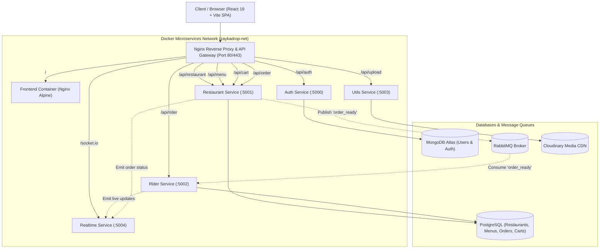

git remote add origin main https://github.com/vishwas789blip/ZaykaDrop-backend# 🍔 ZaykaDrop

> A modern, scalable, event-driven microservices food delivery platform powered by **Node.js**, **TypeScript**, **PostgreSQL**, **MongoDB**, **RabbitMQ**, **Socket.IO**, and **React**.

---

## 📌 Architecture Overview

ZaykaDrop is built on a distributed microservices architecture designed for high availability, ACID transactional consistency, and real-time updates.



---

## 🛠️ Microservices Breakdown

| Service | Port | Database / Storage | Responsibilities |
|---|---|---|---|
| **`frontend`** | `5173` (dev) / `80` (prod) | Static (Nginx) | Responsive React UI, Leaflet live maps, role-based dashboards (Customer, Seller, Rider). |
| **`auth`** | `5000` | MongoDB Atlas | Google OAuth2, email authentication, role management (`customer`, `seller`, `rider`), JWT issuance. |
| **`restaurent`** | `5001` | PostgreSQL (`pg`) | Restaurants, menus, cart management, address book, ACID order checkout, Haversine geospatial search. |
| **`rider`** | `5002` | PostgreSQL (`pg`) | Rider profiles, live GPS coordinates, order broadcast consumption, atomic order claiming, earnings. |
| **`utils`** | `5003` | Cloudinary CDN | Secure internal image uploads for restaurant banners, dishes, and rider document verification. |
| **`realtime`** | `5004` | In-Memory / WebSockets | Bi-directional Socket.IO gateway for real-time order tracking, status transitions, and rider location updates. |

---

## ✨ Key Features

- **Geospatial Restaurant Discovery:** Native Haversine SQL formula calculating accurate distance (in meters) within customizable radiuses (5km, 50km).
- **ACID Transactional Checkout:** Order placement and cart clearing are executed inside a single PostgreSQL atomic transaction (`withTransaction`) to guarantee zero ghost carts or duplicate orders.
- **Atomic Order Assignment:** When a rider accepts an order, PostgreSQL executes a conditional atomic update (`WHERE rider_id IS NULL`) to eliminate race conditions between multiple competing riders.
- **Event-Driven Dispatch:** RabbitMQ decouples restaurant order preparation from rider dispatching.
- **Live Order & GPS Tracking:** Customers and restaurants receive real-time location and status telemetry over WebSockets.
- **Zero-CORS Production Setup:** Root Nginx reverse proxy routes all microservices on a single unified domain.

---

## 🚀 Quick Start (Local Development)

### 1. Prerequisites
- [Docker Desktop](https://www.docker.com/products/docker-desktop/) (running)
- [Node.js](https://nodejs.org/) v20+ and `npm`

### 2. Clone the Repository
```bash
git clone https://github.com/your-username/zaykaDrop.git
cd zaykaDrop
```

### 3. Start the Backend & Database Stack with Docker
```bash
docker compose up -d
```
This starts:
- PostgreSQL (Port `5432`)
- RabbitMQ & Management Dashboard (Ports `5672`, `15672`)
- Auth Service (Port `5000`)
- Restaurant Service (Port `5001`)
- Rider Service (Port `5002`)
- Utils Service (Port `5003`)
- Realtime Service (Port `5004`)

Verify that all containers are healthy:
```bash
docker ps
```

### 4. Seed Initial Restaurant & Rider Data
```bash
# Seed restaurants, menus, and addresses into PostgreSQL:
node services/restaurent/seed.js

# Seed sample riders into PostgreSQL:
node services/rider/seed.js
```

### 5. Start Frontend Dev Server
```bash
cd frontend
npm install
npm run dev
```
Open **[http://localhost:5173](http://localhost:5173)** in your browser!

---

## 🩺 Health Check Endpoints

Every microservice exposes a `/health` endpoint for monitoring and container orchestration:

```bash
# Auth Service
curl http://localhost:5000/health

# Restaurant Service
curl http://localhost:5001/health

# Rider Service
curl http://localhost:5002/health

# Utils Service
curl http://localhost:5003/health

# Realtime Service
curl http://localhost:5004/health
```

Expected Response:
```json
{
  "status": "ok",
  "service": "restaurant-service",
  "timestamp": "2026-11-10T18:11:21.241Z"
}
```

---

## 🌐 Production Deployment

For complete instructions on deploying to cloud providers (AWS EC2, DigitalOcean, Neon, MongoDB Atlas, CloudAMQP, Vercel), see the full guide:

📖 **[PRODUCTION_DEPLOYMENT.md](./PRODUCTION_DEPLOYMENT.md)**

### Production Deployment via Docker Compose
```bash
# 1. Create your production environment file
cp .env.production.example .env.production

# 2. Fill in your secrets (Neon PostgreSQL, Mongo Atlas, RabbitMQ, Cloudinary)
nano .env.production

# 3. Build and launch all services with Nginx Reverse Proxy
docker compose -f docker-compose.prod.yml --env-file .env.production up -d --build
```

---

## 🔒 Security Best Practices Implemented

- **Inter-Service Authentication:** Internal routes (`/api/upload`, `/api/order/assign/rider`, etc.) require an `x-internal-key` header matching `INTERNAL_SERVICE_KEY`.
- **Role-Based Access Control (RBAC):** Middleware guards protect seller (`isSeller`) and rider actions from unauthorized access.
- **Graceful Shutdown:** All Node.js services catch `SIGTERM` and `SIGINT` to safely drain active database connection pools and HTTP requests before exiting.
- **Connection Resiliency:** Serverless PostgreSQL idle disconnects (e.g. Neon scale-to-zero) are automatically handled without process crashes.
- **Docker Log Rotation:** Production containers cap logs at `10m` with a max of 3 files to prevent server disk saturation.

---

## 📄 License
This project is licensed under the MIT License.

